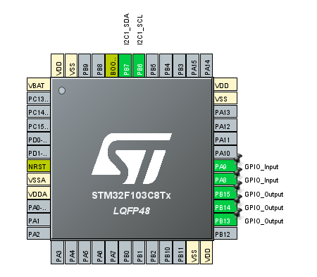

## Check the code output using the (.elf file) on to your micrcontroller.
Here is the project, where we can choose the option we want using the push button 8 edge detection (counting) . Push button 9 is for selecting that option.
## Program Output

Here is the pin configuration of CubeMX

